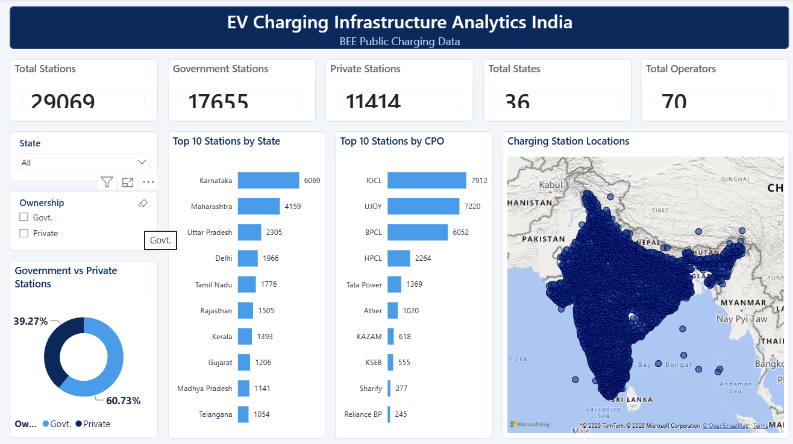
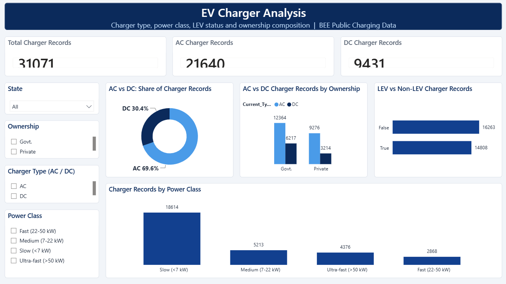
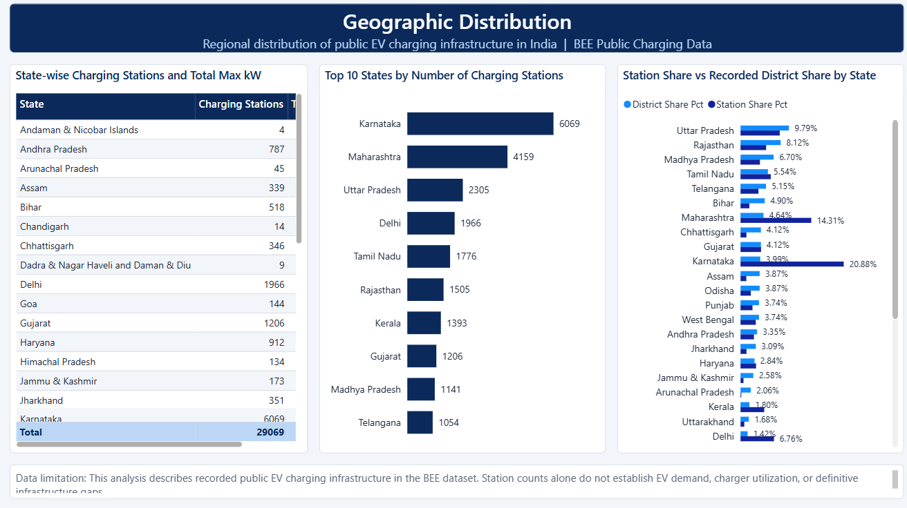

# EV Charging Infrastructure Analytics – India 🇮🇳

## 📌 Project Overview

The rapid growth of Electric Vehicles (EVs) in India has increased the need for a well-distributed and accessible charging infrastructure. Understanding the availability and distribution of charging stations is essential for identifying infrastructure gaps and supporting future planning.

This project focuses on analyzing India's EV charging infrastructure using data analytics techniques to explore the distribution of charging stations and chargers across different states, cities, operators, charger types, and power categories.

## 🎯 Project Objectives

- Analyze the distribution of EV charging stations across Indian states and districts.
- Examine Government and Private sector contributions to charging infrastructure.
- Identify the distribution of AC and DC chargers.
- Analyze charger types, connector standards, and power categories.
- Explore infrastructure distribution patterns and potential geographical gaps.
- Present key findings through an interactive Power BI dashboard.

## 🛠️ Tools & Technologies

| Tool | Purpose |
|---|---|
| Python | Data cleaning and preprocessing |
| Pandas | Data manipulation |
| NumPy | Numerical operations |
| Matplotlib & Seaborn | Exploratory data visualization |
| MySQL | Data querying and analysis |
| Power BI | Interactive dashboard development |

## 📂 Dataset

The project uses India's EV charging infrastructure dataset obtained from the Bureau of Energy Efficiency (BEE).

The dataset contains information related to:
- Charging station locations
- State, district and city details
- Charging station operators
- Government and Private ownership
- Charger types and connector standards
- Charger power categories

## ⚙️ Project Workflow

### 1. Data Collection
Collected EV charging infrastructure datasets from the Bureau of Energy Efficiency (BEE).

### 2. Data Cleaning and Preprocessing
- Checked missing values and duplicate records.
- Standardized inconsistent location names.
- Performed data validation and preprocessing.
- Prepared datasets for further analysis.

### 3. Exploratory Data Analysis (EDA)
- Examined state-wise and regional charging infrastructure distribution.
- Analyzed charger types and power categories.
- Explored Government and Private sector contributions.
- Identified important patterns and variations in the dataset.

### 4. SQL Analysis
Used MySQL to perform analytical queries and examine:
- State-wise charging station distribution.
- Operator-wise station distribution.
- AC and DC charger distribution.
- Charger power categories.
- Government and Private infrastructure distribution.

### 5. Power BI Dashboard
Developed an interactive dashboard to present key insights through visualizations, charts, KPIs and filters.

## 📊 Dashboard Preview

### 1. Overview Dashboard

### 2. Charger Analysis

### 3. Geographical Analysis

## 📊 Key Findings

The analysis explores:
- States with higher EV charging infrastructure availability.
- Major charging station operators.
- Government versus Private sector contributions.
- AC and DC charger distribution.
- Distribution of chargers across different power categories.

## 💡 Project Outcome

This project demonstrates the practical application of Python, SQL and Power BI in analyzing real-world infrastructure data. It provides insights into India's EV charging infrastructure distribution and helps highlight areas that may require further infrastructure development.

## 👩‍💻 Author

**Ramseena M**

Aspiring Data Analyst

- GitHub: https://github.com/ramzinaa
- LinkedIn: https://linkedin.com/in/ramseena-m-48b6a53b3/
